# Mini-GAN — DCGAN & conditional GAN on MNIST

A compact PyTorch implementation of a **DCGAN** and a **class-conditional GAN (cGAN)** trained from scratch on MNIST: a hand-written adversarial training loop, a quantitative classifier-based evaluation (MNIST-IS, MNIST-FID, memorisation check), pretrained weights and a test suite.

 

<p align="center">
  
  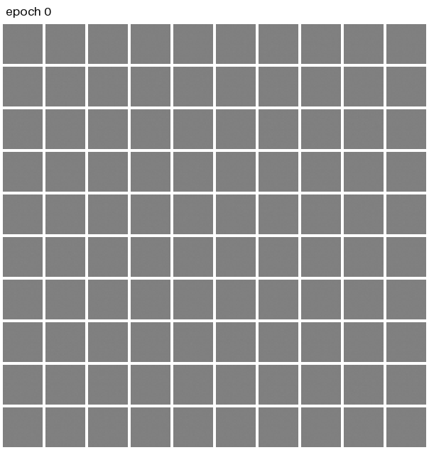
</p>
<p align="center"><sub>Fixed latent batch decoded after each epoch: conditional GAN (left, column <i>j</i> is digit <i>j</i>) and unconditional DCGAN (right).</sub></p>

## Key results

Final evaluation of the committed generators (seed 0, epoch 50) on **10,000 fresh samples**, scored against the 10,000 MNIST test images (`python evaluate.py`, see [`results/metrics.json`](results/metrics.json)):

| | MNIST-FID ↓ | MNIST-IS ↑ | Label accuracy ↑ | Median NN distance to train |
|---|---:|---:|---:|---:|
| Real data (reference) | 0.056 <sub>train subset vs test</sub> | 9.71 <sub>test set</sub> | — | 8.67 <sub>test → train</sub> |
| **DCGAN** | 0.515 | 8.34 ± 0.11 | — | 9.42 |
| **cGAN** | **0.145** | **9.70 ± 0.03** | **99.14 %** | 9.24 |

Seed study, with the same protocol applied to three independent training runs (seeds 0, 1, 2; mean ± sample std):

| Configuration | MNIST-FID ↓ | MNIST-IS ↑ | Label accuracy ↑ |
|---|---:|---:|---:|
| DCGAN, label smoothing 0.1 (default) | 0.522 ± 0.026 | 8.28 ± 0.05 | — |
| DCGAN, no label smoothing (ablation) | 0.534 ± 0.028 | 8.26 ± 0.05 | — |
| cGAN, label smoothing 0.1 (default) | 0.122 ± 0.026 | 9.72 ± 0.02 | 99.27 % ± 0.12 |

**Reading the numbers.**

* **Conditioning closes most of the gap.** The cGAN reaches an MNIST-FID of 0.145, against 0.515 for the DCGAN and a real-data floor of 0.056. Its MNIST-IS (9.70) matches the real test images (9.71), and the classifier recognises the requested digit in 99.1 % of samples. The IS is saturated at this level, so FID is the more discriminative metric.
* **Evaluation noise vs. real differences.** Re-scoring each generator on 5 independent 10,000-sample sets gives an FID standard deviation of 0.026 (DCGAN) and 0.011 (cGAN). This is far below the DCGAN–cGAN gap, and explains why the epoch-50 values on the training curves (another sample set) differ slightly from the table.
* **Label-smoothing ablation.** DCGAN with one-sided label smoothing 0.1 reaches MNIST-FID 0.522 ± 0.026 (IS 8.28 ± 0.05), against 0.534 ± 0.028 (IS 8.26 ± 0.05) without smoothing. Per-seed FID: 0.514, 0.501, 0.550 vs 0.522, 0.566, 0.514. The difference (+0.012 FID for removing smoothing, Welch t = 0.5 with 3 seeds per arm) is within seed-to-seed variation: no reliable effect can be claimed at this sample size.
* **No sign of memorisation.** The median distance from a generated sample to its nearest training image (9.42 DCGAN, 9.24 cGAN) is *larger* than for real held-out test images (8.67). Only 0.41 % / 0.20 % of samples are closer to a training image than the 1st percentile of test images (1 % by definition for real data). The low-distance mode of the histogram (d ≈ 3) is almost entirely the digit 1, a single thin stroke, for real and generated images alike.
* **Mode coverage.** The unconditional DCGAN uses every digit. The classifier assigns between 9.02 % (digit 5) and 11.31 % (digit 7) of its samples to each class, close to the 8.92–11.35 % spread of the real test set. There is no visible mode collapse.

## Visual results

<p align="center">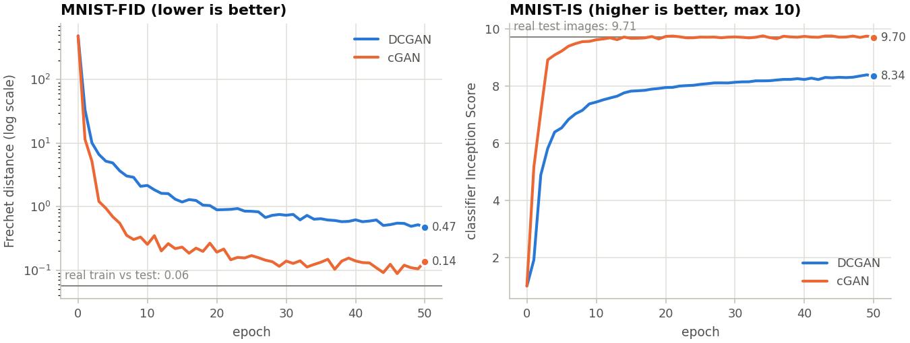</p>

**Metrics per epoch** (10,000 samples per point, fixed sampling seed). The DCGAN improves steadily for all 50 epochs. The cGAN gets within reach of the real-data references after about 10 epochs and then fluctuates: its per-epoch FID varies by more than the evaluation noise (best 0.088 at epoch 46, last 0.137). The **last** epoch is reported, because choosing the best one would select on the test set.

<p align="center">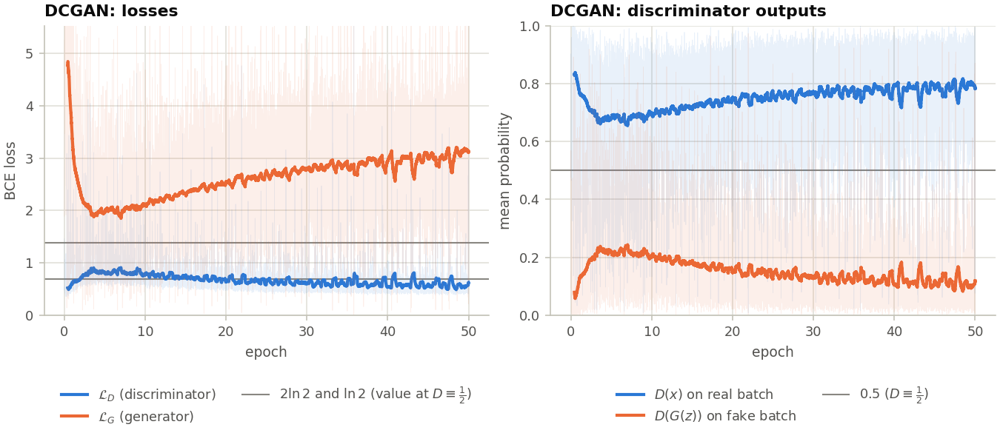</p>
<p align="center">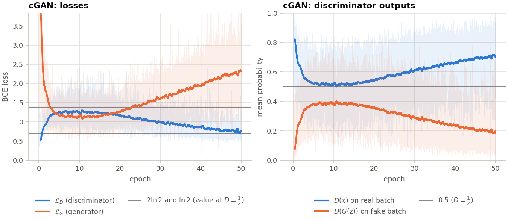</p>

In both runs the discriminator slowly gains the upper hand: $D(x)$ rises, $D(G(z))$ falls and $\mathcal{L}_G$ climbs well above $\ln 2$. Yet the sample-quality metrics keep improving. GAN losses are not a measure of sample quality. The conditional game stays much closer to equilibrium during its first 20 epochs.

| DCGAN samples (seed 0, uncurated) | cGAN: one latent code per row, digits 0–9 per column |
|---|---|
| 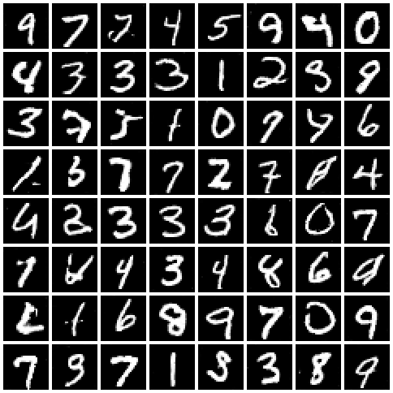 | 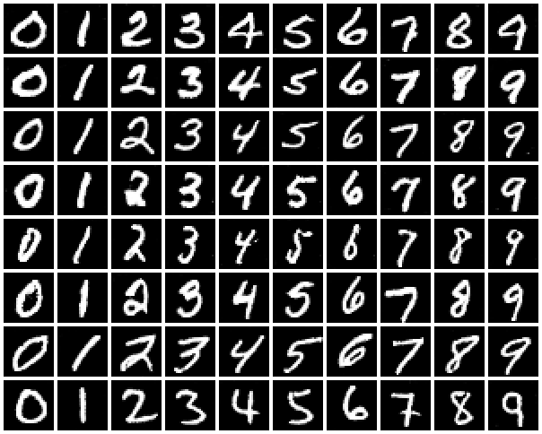 |

| Latent walks (slerp), DCGAN | Latent walks, cGAN (same path for every digit) | `python demo.py --digit 7` |
|---|---|---|
| 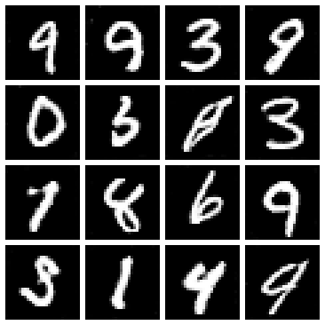 | 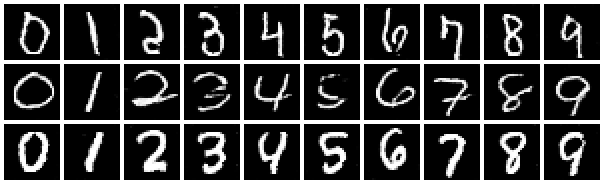 | 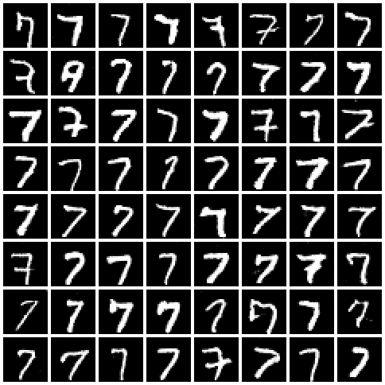 |

| Nearest training images of DCGAN samples | Distance to the nearest training image |
|---|---|
| 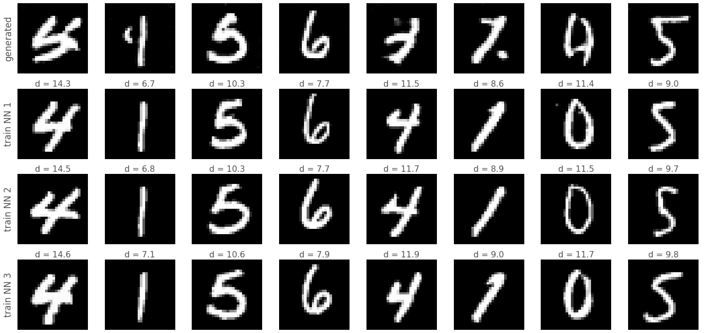 | 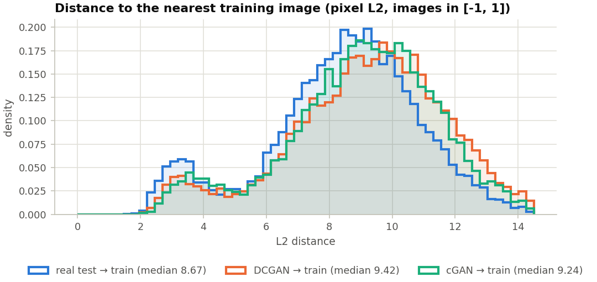 |

<p align="center">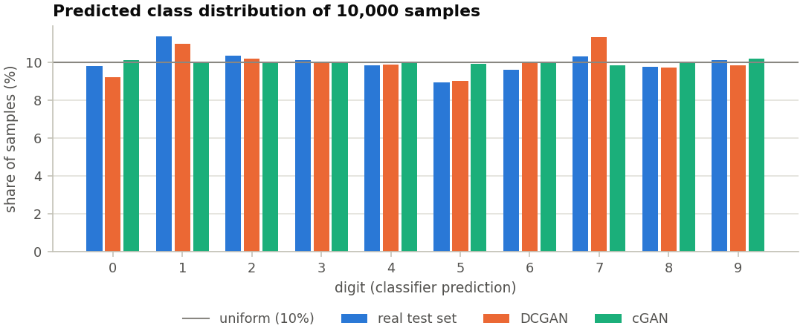</p>

## How it works

### Adversarial objective

A generator $G$ maps a latent code $z \sim \mathcal{N}(0, I_{100})$ to an image. A discriminator $D$ outputs the probability that an image is real. The two networks play the minimax game of Goodfellow et al. (2014):

$$
\min_G \max_D \; V(D, G) = \mathbb{E}_{x \sim p_{\text{data}}}\big[\log D(x)\big] + \mathbb{E}_{z \sim p_z}\big[\log\big(1 - D(G(z))\big)\big].
$$

For a fixed $G$ the optimal discriminator is $D^*(x) = \frac{p_{\text{data}}(x)}{p_{\text{data}}(x) + p_g(x)}$, and the generator objective becomes $-\log 4 + 2\,\mathrm{JSD}(p_{\text{data}} \,\|\, p_g)$. Its global minimum is reached when $p_g = p_{\text{data}}$, where $D \equiv \tfrac12$.

### Losses actually optimised

$D$ outputs a logit $\ell$, with $D = \sigma(\ell)$, and both losses use `BCEWithLogitsLoss` for numerical stability. With one-sided label smoothing $s$ (real target $1-s$, fake target $0$):

$$
\mathcal{L}_D = -\,\mathbb{E}_x\big[(1-s)\log \sigma(\ell(x)) + s \log(1-\sigma(\ell(x)))\big] \;-\; \mathbb{E}_z\big[\log\big(1-\sigma(\ell(G(z)))\big)\big].
$$

Early in training $D(G(z)) \approx 0$, and $\log(1 - D(G(z)))$ saturates: its gradient with respect to the logit vanishes. The generator therefore minimises the **non-saturating** loss instead:

$$
\mathcal{L}_G = -\,\mathbb{E}_z\big[\log \sigma(\ell(G(z)))\big] = \mathbb{E}_z\big[\mathrm{softplus}(-\ell(G(z)))\big],
$$

which has the same fixed point but strong gradients when $D$ confidently rejects fakes. At equilibrium ($D \equiv \tfrac12$, whatever $s$), $\mathcal{L}_D = 2\ln 2 \approx 1.386$ and $\mathcal{L}_G = \ln 2 \approx 0.693$. These reference lines appear in the training curves.

### Conditional GAN

With `--conditional`, both players receive the class label $y$ (Mirza & Osindero, 2014): $G(z, y)$ concatenates a learned 10-d label embedding to $z$, and $D(x, y)$ receives a learned $28\times 28$ label map as a second input channel. The objective becomes

$$
\min_G \max_D \; \mathbb{E}_{(x,y)}\big[\log D(x, y)\big] + \mathbb{E}_{z,\,y}\big[\log\big(1 - D(G(z, y), y)\big)\big],
$$

so the generator can be asked for a specific digit.

### Training loop (one step)

```python
# simplified from minigan/training.py::train_step (bce = binary_cross_entropy_with_logits)
fake = generator(z, fake_labels)
# 1) discriminator: real -> 1 - s, fake -> 0   (G frozen through .detach())
loss_d = bce(D(real, real_labels), 1 - s) + bce(D(fake.detach(), fake_labels), 0)
# 2) generator: non-saturating loss through the freshly updated D
loss_g = bce(D(fake, fake_labels), 1)
```

Adam with `lr=2e-4, betas=(0.5, 0.999)` for both players, DCGAN initialisation (conv weights $\sim\mathcal{N}(0, 0.02)$, BatchNorm $\gamma \sim \mathcal{N}(1, 0.02)$). $\mathcal{L}_D$, $\mathcal{L}_G$, $D(x)$ and $D(G(z))$ are logged at every step. See [`minigan/training.py`](minigan/training.py).

### Quantitative evaluation (and its caveats)

The standard IS and FID use an ImageNet Inception-v3, which is meaningless on 28×28 grayscale digits. Both metrics are therefore computed with a **small MNIST classifier trained in this repository** (`train_classifier.py`, 99.41 % test accuracy):

* **MNIST-IS** (classifier Inception Score): $\exp\big(\mathbb{E}_x\,\mathrm{KL}\big(p(y\mid x)\,\|\,p(y)\big)\big)$, mean ± std over 10 splits. It ranges from 1 to 10. It is high when every sample is confidently recognised *and* all digits are used.
* **MNIST-FID** (Fréchet distance on the classifier's 128-d penultimate features) between 10,000 generated samples and the 10,000 MNIST **test** images:

$$
\mathrm{FD} = \lVert \mu_r - \mu_g \rVert_2^2 + \mathrm{Tr}\big(\Sigma_r + \Sigma_g - 2\,(\Sigma_r \Sigma_g)^{1/2}\big).
$$

> [!IMPORTANT]
> These are **not** the standard Inception-v3 FID / IS. The feature space is different, so the absolute values are on a different scale and are only comparable *within this repository* (same classifier, same sample sizes). The real-data row of the results table gives the reference values (FID floor, IS ceiling).

* **Memorisation check**: exact nearest neighbours in pixel space (L2) of every generated sample among the 60,000 training images. These distances are compared with those of the held-out test images to the training set.

## Architecture

| Network | Layers (output size) | Params (uncond. / cond.) |
|---|---|---|
| **Generator** | $z$ (100, + 10-d label embedding) → ConvT 3×3 → 256×3×3 → ConvT 3×3 s2 → 128×7×7 → ConvT 4×4 s2 → 64×14×14 → ConvT 4×4 s2 → 1×28×28, BatchNorm + ReLU, `tanh` output | 658,305 / 681,445 |
| **Discriminator** | 1×28×28 (+ label plane) → Conv 4×4 s2 → 64×14×14 → Conv 4×4 s2 → 128×7×7 → Conv 3×3 s2 → 256×4×4 → Conv 4×4 → 1 logit; LeakyReLU(0.2), BatchNorm except on the first layer | 431,937 / 440,801 |
| **Evaluation classifier** | [Conv 3×3 + BN + ReLU]×2 → pool → [Conv]×2 → pool → Conv(128) → global average pool (**128-d features**) → Linear(10) | 140,458 |

Images are scaled to $[-1, 1]$. The full MNIST split is kept as a single tensor on the device, which removes `DataLoader` overhead: one 468-step epoch took 3.2–6.5 s on a shared RTX 5070 Ti.

## Project structure

```
mini_gan/
├── minigan/                 # importable package
│   ├── models.py            # Generator, Discriminator (DCGAN / cGAN), DCGAN init
│   ├── training.py          # train_step (adversarial update) and fit (epoch loop, logging)
│   ├── metrics.py           # Frechet distance, classifier IS, Evaluator, nearest neighbours
│   ├── classifier.py        # MNIST CNN used as feature extractor for the metrics
│   ├── sampling.py          # seeded latents, batched generation, slerp interpolation
│   ├── checkpoint.py        # resumable training state, compact fp16 generator export
│   ├── data.py              # MNIST as in-memory tensors + mini-batch iterator
│   ├── viz.py               # grids, GIFs and plots
│   └── utils.py             # seeding, device selection
├── train_classifier.py      # 1) train the evaluation classifier
├── train.py                 # 2) train a DCGAN or a cGAN (--conditional)
├── evaluate.py              # 3) final metrics, memorisation check, comparison figures
├── demo.py                  # sample from the pretrained generators (no training needed)
├── tests/                   # pytest suite (CPU, a few seconds)
├── weights/                 # committed: dcgan/cgan generators (fp16) + evaluation classifier
├── assets/                  # figures used in this README
├── results/                 # metrics.json + per-epoch training histories
├── requirements.txt
├── pyproject.toml           # pytest configuration
└── LICENSE
```

## Quickstart

```bash
git clone https://github.com/stein900/mini_gan.git
cd mini_gan
python -m venv .venv && source .venv/bin/activate      # Windows: .venv\Scripts\activate
pip install -r requirements.txt                       # install the CUDA build of torch first if you have a GPU
```

**Demo (no training, uses the committed weights):**

```bash
python demo.py               # sample grids, interpolation GIFs, class grid  ->  assets/
python demo.py --digit 7     # + a grid of 7s drawn by the conditional generator
python demo.py --model dcgan --seed 3 --out-dir samples
```

**Full pipeline** (MNIST is downloaded to `data/` on first use):

```bash
python train_classifier.py              # evaluation classifier -> weights/mnist_classifier.pt
python train.py                         # DCGAN, 50 epochs      -> runs/dcgan/
python train.py --conditional           # cGAN, 50 epochs       -> runs/cgan/
python evaluate.py                      # results/metrics.json + assets/*.png
python train.py --epochs 3 --device cpu --eval-samples 2000 --run-name dcgan_cpu   # quick CPU run
```

`train.py --publish` additionally refreshes `weights/<run>_generator.pt` (float16), `assets/<run>_*.{png,gif}` and `results/<run>_history.json`. `--resume` continues from `runs/<run>/checkpoint.pt`. Main options: `--epochs`, `--batch-size`, `--lr`, `--beta1/--beta2`, `--label-smoothing`, `--latent-dim`, `--seed`, `--device`.

**Tests:**

```bash
python -m pytest            # 43 tests, CPU only
```

## Reproducibility

* **Seeds.** `--seed` seeds Python, NumPy and PyTorch, the per-epoch shuffling uses its own seeded generator, and latent codes for evaluation and the demo come from a dedicated CPU generator (identical on CPU and GPU). cuDNN autotuning is disabled. Re-running a published configuration on the same machine reproduced the per-epoch metrics digit for digit. Bitwise equality across different GPUs or library versions is not guaranteed.
* **Hardware and software.** NVIDIA GeForce RTX 5070 Ti (16 GB), shared with other jobs during these runs; Windows 11, Python 3.12, PyTorch 2.12 (CUDA 12.8), torchvision 0.27.
* **Measured runtime** (wall clock, including the per-epoch evaluation on 10,000 samples):

| Step | Time |
|---|---:|
| Evaluation classifier, 5 epochs (`train_classifier.py`) | 7.8 s |
| DCGAN, 50 epochs (`train.py`) | 3.6 min (4.0 s / epoch of training) |
| cGAN, 50 epochs (`train.py --conditional`) | 3.4 min (3.9 s / epoch of training) |
| Final evaluation (`evaluate.py`, both models + references) | 8 s (GPU, incl. 5 FID resamples per model and the 9-run seed study) |
| Test suite (`pytest`, CPU) | 2.3 s (43 tests passed) |
| DCGAN, 3 epochs on CPU (`--device cpu --eval-samples 2000`) | 2.0 min (MNIST-FID 6.91 after 3 epochs) |

* **Float16 export.** The committed generators are stored in float16 (1.3 MB each) and cast back to float32 at load time. Scored with the same protocol, the float32 run checkpoints give MNIST-FID 0.5145 (DCGAN) and 0.1448 (cGAN), against 0.5147 and 0.1448 for the float16 files: the export does not change the results.
* **Artifacts.** `results/<run>_history.json` holds the per-epoch losses, discriminator outputs and metrics of the published runs. Full per-step logs and resumable checkpoints are written to `runs/` (git-ignored). The seed study re-uses `runs/<run>/generator.pt`:

```bash
python train.py --seed 1 --run-name dcgan_seed1          # likewise dcgan_seed2, cgan_seed1/2 (--conditional)
python train.py --label-smoothing 0 --run-name dcgan_nols # likewise dcgan_nols_seed1/2
python evaluate.py --seed-study "DCGAN=runs/dcgan,runs/dcgan_seed1,runs/dcgan_seed2" \
                   --seed-study "DCGAN (no smoothing)=runs/dcgan_nols,runs/dcgan_nols_seed1,runs/dcgan_nols_seed2" \
                   --seed-study "cGAN=runs/cgan,runs/cgan_seed1,runs/cgan_seed2"
```

## Limitations & next steps

* **Discriminator drift.** In both models $D$ slowly overpowers $G$ (rising $\mathcal{L}_G$, falling $D(G(z))$). Within 50 epochs this does not hurt the metrics, but it is the usual precursor of instability in longer runs. Spectral normalisation, an R1 gradient penalty, a two-time-scale learning rate (TTUR) or a Wasserstein loss with gradient penalty are the natural next steps.
* **Model selection.** The per-epoch FID is computed on the test set, so it is only used for monitoring, never for choosing a checkpoint. Early stopping or checkpoint averaging (an EMA of generator weights) should be driven by a validation split held out from the 60,000 training images.
* **Metric caveats.** MNIST-IS and MNIST-FID depend on one small classifier, and the FID estimator is biased by the sample size: all comparisons use exactly 10,000 vs 10,000 images. The values are not comparable with Inception-v3 FID/IS from the literature. IS saturates for the cGAN; precision/recall metrics (Kynkäänniemi et al., 2019) would separate fidelity from diversity.
* **Sample defects.** A visible fraction of DCGAN samples are still malformed or ambiguous, consistent with its lower IS. The cGAN removes most of them.
* **Memorisation test.** Pixel-space L2 is a coarse similarity measure. A stronger test would add feature-space neighbours or a copy-detection model.
* **Scope.** MNIST only. Harder datasets (Fashion-MNIST, CIFAR-10) would need wider networks and the stabilisation techniques above.

## References

1. I. Goodfellow et al., *Generative Adversarial Nets*, NeurIPS 2014.
2. A. Radford, L. Metz, S. Chintala, *Unsupervised Representation Learning with Deep Convolutional Generative Adversarial Networks* (DCGAN), ICLR 2016.
3. M. Mirza, S. Osindero, *Conditional Generative Adversarial Nets*, arXiv:1411.1784, 2014.
4. T. Salimans et al., *Improved Techniques for Training GANs* (Inception Score, one-sided label smoothing), NeurIPS 2016.
5. M. Heusel et al., *GANs Trained by a Two Time-Scale Update Rule Converge to a Local Nash Equilibrium* (FID), NeurIPS 2017.
6. T. White, *Sampling Generative Networks* (spherical interpolation), arXiv:1609.04468, 2016.

## License

[MIT](LICENSE) © 2026 Raphaël Laurent

## Author

**Raphaël Laurent**, AI Scientist / computer engineer. Full technical write-up: [stein-ind.fr/Portfolio/projects/mini_gan.html](https://stein-ind.fr/Portfolio/projects/mini_gan.html)
